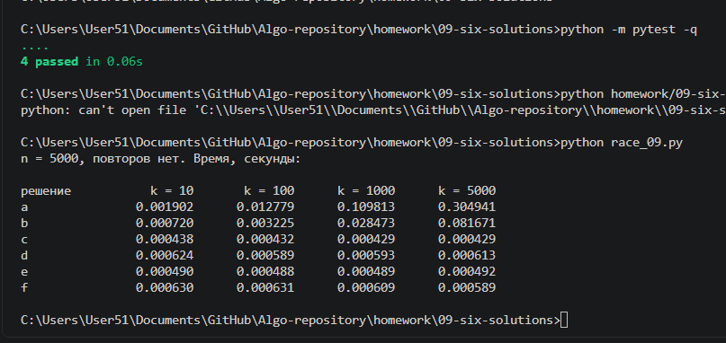

# Домашняя работа № 9 · Шесть решений, одна задача

**Дисциплина:** ОП.04 «Основы алгоритмизации и программирования»

| Поле | Значение |
|---|---|
| Фамилия, имя, отчество | Клейновский Максим Андреевич |
| Группа | 9/3-РПО-24/2 |
| Номер работы | 9 |
| Тема работы | Разбор шести решений задачи «повтор рядом» |
| Дата сдачи | 24.11 |
| Ветка | `hw-09` |

Сначала оцените решения по коду. Затем проверьте свои выводы тестами и гонкой.
Главный результат этой работы — объяснение, почему правдоподобный код может
давать неверный ответ или не укладываться в ограничение.

---

## 1. Чтение решений

Заполните до запуска гонки. Время оценивайте через n (длина списка) и k.

| Решение | Время | Верно? |
|---|---|---|
| A | O(n*k): вложенный цикл по следующим k проходам | да |
| B | O(n*k): срез списка и проверка вхождения `in` | да |
| C | O(n): словарь хранит последний индекс числа | да |
| D | O(n): скользящее окно из множества (set) | да |
| E | O(n): словарь хранит первый индекс числа | нет |
| F | O(n): скользящее окно из множества (set) | нет |

В решении B нет вложенного `for`. Где в нём спрятан второй цикл: внутри in при проверке среза nums[i + 1:i + k + 1] (Создаёт новый список из k элементов, а in перебирает их по одному)

---

## 2. Две ошибки

Контрпримеры записаны в `counterexamples_09.py`. Здесь объясните по коду,
что идёт не так и какую строку исправить.

Первое ошибочное решение E: Оно запоминает индекс только первого вхождения числа и если число встретилось далеко, а затем дважды подряд, решение E сравнивает новый индекс с самым первым и решает, что расстояние слишком большое, пропуская верную пару.

Второе ошибочное решение F: удаляет элемент из окна слишком поздно. В итоге из-за условия окно имеет размер k+1, и решение F нверно считает парой числа, расстояние между которыми = k+1.

Как вы искали ошибки: чтением кода, стресс-тестом или и так и так: чтением кода.

Одно из ошибочных решений проходит все три примера из условия. Какое,
и какого примера в условии не хватает, чтобы его поймать: Это решение E -в условии не хватает примера, где число повторяется рядом, но его первое вхождение было давно. Например [1, 2, 1, 1], k = 1. True, а E скажет False

---

## 3. Гонка

Совпала ли гонка с вашей таблицей: у каких решений время растёт вместе с k: Да, совпала. Время растет у решений A и B. У решений C, D, E и F время остается неизменным (их сложность не зависит от k.)

A и B — оба O(n·k), но B заметно быстрее. Почему, если сложность одинаковая: В решении B создание среза и проверку in выполняют встроенные функции, написанные на C. В решении A используется вложенный цикл на Питоне, где на каждую итерацию тратится много времени на интерпретацию кода. 

---

## 4. Решение интервьюера

C и D работают за O(n). Какое из них вы бы взяли и в каком случае
выбрали бы другое:  По результатам решение C оказалось самым быстрым, я бы взял его, но C хранит в словаре все уникальные элементы, поэтому в худшем случае занимает O(n) памяти. Решение D использует память O(min(n, k)), так как хранит окно только из k элементов. Поэтому D стоило бы выбрать тогда, когда k маленькое, а список nums очень большой (чтобы сэкономить оперативную память).

---

ИИ: использовал для правки ошибок в тексте перед вставкой. 
