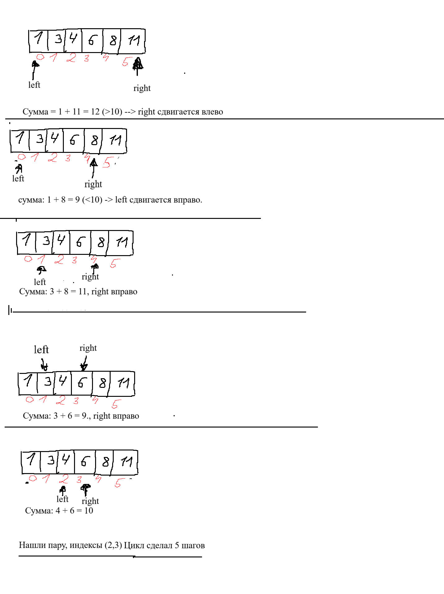
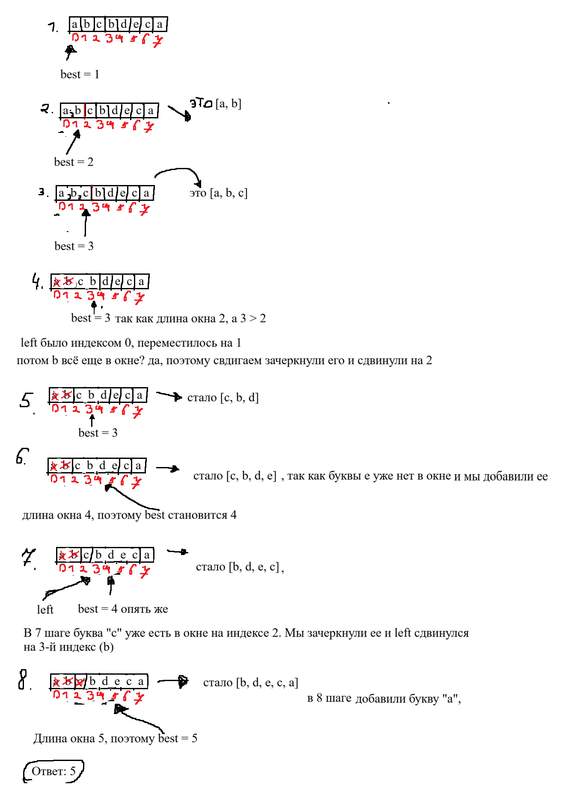

# Домашняя работа № 10 · Трассировка на бумаге

**Дисциплина:** ОП.04 «Основы алгоритмизации и программирования»

| Поле | Значение |
|---|---|
| Фамилия, имя, отчество | Клейновский Максим Андреевич |
| Группа | 9/3-РПО-24/2 |
| Номер работы | 9 |
| Тема работы | Разбор шести решений задачи «повтор рядом» |
| Дата сдачи | 24.11 |
| Ветка | `hw-10` |

Трассировка показывает состояние алгоритма после каждого шага. Фотографии
первых двух задач фиксируют ход рассуждения, а таблица кэша помогает сравнить
две политики вытеснения на одной последовательности запросов.

---

## 1. Пара с суммой

Ответ функции и сколько шагов сделал цикл: ___

На первом шаге сумма 1 + 11 = 12 больше 10, и `right` сдвигается.
Почему число 11 больше ни с кем не нужно проверять: Массив отсортирован и если 11 + 1 > 10, то с любыми другими числами сумма будет >. 11 можно отбросить.

---

## 2. Самая длинная подстрока без повторов

Ответ функции и сама подстрока: 5, подстрока "bdeca".

При `right = 3` (буква `b`) цикл `while` убирает две буквы. Почему мало
убрать одну `b`: Потому что текущее окно было "abc". Убрать только 'a' и окно станет "bc". Если добавить новую 'b', окно станет "bcb", и в нем останется дубликат. Нужно убрать и 'a', и старую 'b', чтобы окно стало "c" и могло принять новую 'b'.

Внутри `for` есть `while`, но время O(n). Сколько раз каждая буква может
войти в окно и выйти из него: Каждая буква входит в окно 1 один раз (когда ее обрабатывает `right`) и выходит из него максимум один раз (когда ее удаляет `left`). Поэтому общее количество операций `while` за весь цикл не > `n`, и время O(n).

---

## 3. LRU и FIFO, кэш на 3 места

Кэш после каждого запроса записывайте от самого старого ключа к самому новому.
Попадание `get` отметьте знаком ✓, промах — знаком ✗.

| Запрос | LRU | FIFO |
|---|---|---|
| put a, b, c | a, b, c | a, b, c |
| get a | ✓ b, c, a | ✓ a, b, c |
| put d 4 | c, a, d (вытеснен b) | b, c, d (вытеснен a) |
| get b | ✗ c, a, d | ✓ b, c, d |
| get c | ✓ a, d, c | ✓ b, c, d |
| put e 5 | d, c, e (вытеснен a) | c, d, e (вытеснен b) |
| get a | ___ | ✗ c, d, e |
| get d | ___ | ✓ c, d, e  |

Попаданий из пяти `get`: у LRU 3, у FIFO 4.

В модуле 20 на большом потоке запросов LRU давал больше попаданий, чем FIFO.
Почему здесь вышло иначе и что из этого следует для выбора политики: Эта последовательность запросов подобрана так, чтобы наказать LRU. Когда мы сделали get a, LRU посчитал a важным и сохранил его, вытеснив b. Но сразу после этого запросили b. FIFO же не меняет порядок при `get`, поэтому вытеснил самую старую a, сохранив b для следующего запроса. Выбор кэширования зависит от данных и в каком порядке они запрашиваются

---

ИИ: не использовал 
