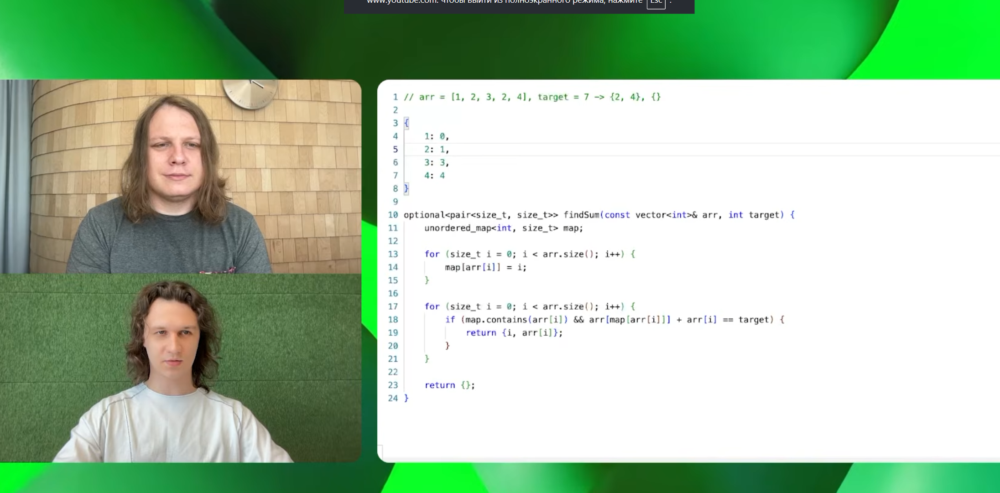
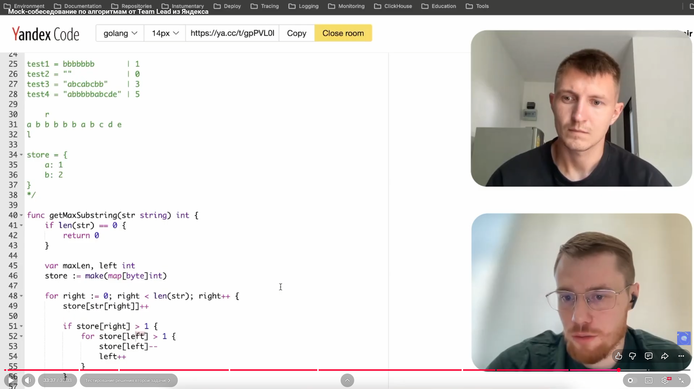

# Домашняя работа № 6 · Как проходит алгоритмическое собеседование

**Дисциплина:** ОП.04 «Основы алгоритмизации и программирования»

| Поле | Значение |
|---|---|
| Фамилия, имя, отчество | Клейновский Максим Андреевич |
| Группа | 9/3-РПО-24/2 |
| Номер работы | 6 |
| Тема работы | Разбор двух записей алгоритмических собеседований |
| Дата сдачи | 24.11 |
| Ветка | `hw-06` |

Смотрите не пересказ видео, а работу кандидата: уточнение условия, проверку
решения примерами и исправление ошибки. Короткие ответы опирайте на конкретный
момент записи.

---

## 1. Видео A · Показательная секция Яндекса

### 1.1. Как устроена секция (около 1:00–3:30)

Час, две задачи, главное — корректность. Код пишут в редакторе без запуска.
Работа над задачей идёт по шагам: записать условие, предложить алгоритм,
оценить время и память, написать код, сдать и проверить.

Что из этих шагов кандидат должен сделать до того, как начнёт писать код,
и зачем интервьюеру это нужно: записать условие, задать вопросы, предложить алгоритм и оценить сложность его по времени и памяти. Ему это надо, чтобы понять, что кандидат правильно понял задачу и не пошёл по неоптимальному пути и умеет рассуждать вслух.

### 1.2. Два решения Two Sum (около 6:30–10:30)

Задача — LeetCode 1, мы решали её на занятии 17.

| | Первое решение | Второе решение |
|---|---|---|
| Идея | сортировка, затем два указателя с краёв | сохранение чисел и индексов в хэш-таблицу и поиск target - num |
| Время и память | O(n log n), O(n) | O(n), O(n) |

Почему интервьюер попросил подумать ещё, хотя первое решение верное: сортировка работает за O(n log n), а с хэш-таблицей код получается работает за O(n).

### 1.3. Ошибка около 20:00

Какую ошибку нашли и на каком тесте: элемент складывался сам с собой, возвращая 2 одинаковых индекса., нашли где из одного элемента arr = [1], target = 1

На занятии 17 мы сначала ищем пару для числа и только потом кладём число
в словарь. Почему в таком порядке эта ошибка невозможна: В момент поиска пары текущего элемента ещё нет в словаре, поэтому он не может найти сам себя.

---

## 2. Видео B · Мок-собеседование с тимлидом

### 2.1. Объединение интервалов (около 4:00–16:30)

Задача — LeetCode 56, модуль 12. Кандидат сначала назвал сложность линейной.
Что он не учёл и какая сложность верная: не учел предвартиельную сортировку интервалов и сложность - O(n log n) по времени и O(n) по памяти

На каком входе код сломался и почему: На пустом входном массиве интервалов [], он до цикла без проверки длины попытался положить нулевой элемент intervals[0] в результирующий слайс.

### 2.2. Самая длинная подстрока без повторов (около 17:00–26:30)

Задача — LeetCode 3, модуль 10.

Первое решение кандидата проверяло каждую подстроку заново. Как он ускорил
его до O(n): добавил хэш-таблицу, обновляя её за O(1) при сдвиге правого и левого указателей 

Почему память O(1), а не O(n), как кандидат сказал сначала: Размер алфавита фиксирован, поэтому в мапе никогда не будет больше константного числа ключей.

### 2.3. Отзыв интервьюера (около 35:00)

Хорошо: кандидат проговаривает ход мысли, его легко поправить.
Над чем работать (две вещи): делать тест-кейсы лучше, уточнять лучше требования до начала написания кода 

---

## 3. Мои правила на собеседование

Два правила, которые вы возьмёте себе. Каждое подкрепите моментом из видео.

| Правило | Момент из видео |
|---|---|
| до кода спросить, может ли вход быть пустым | видео B, 15:30: код сломался на пустом списке интервалов |
| проверять код на дубликатах и массиве из одного элемента | видео A на 20:00: элемент складывался сам с собой на тесте с 1 числом |
| уточнять ограничения регистра  | видео B на 26:40 и 35:40 он не сразу спросил про регистр и ASCII |

---

ИИ: использовал для проверки формулировко своих ответов
