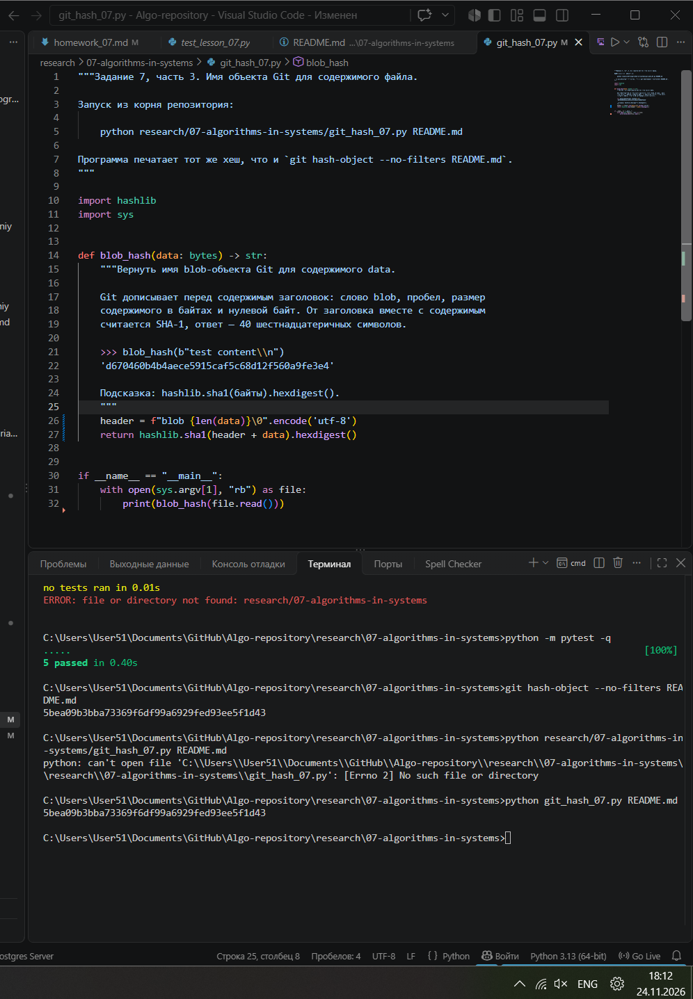

# Домашняя работа № 7 · Алгоритмы курса в настоящих системах

**Дисциплина:** ОП.04 «Основы алгоритмизации и программирования»

| Поле | Значение |
|---|---|
| Фамилия, имя, отчество | Клейновский Максим Андреевич |
| Группа | 9/3-РПО-24/2 |
| Номер работы | 7 |
| Тема работы | LRU в Redis, словарь Python и объекты Git |
| Дата сдачи | 24.11 |
| Ветка | `hw-07` |

По источникам объясните, какую задачу решают знакомые структуры в Redis,
Python и Git. Ответы должны связывать механизм системы с идеей алгоритма,
а не пересказывать текст документации.

---

## 1. Redis: вытеснение ключей при нехватке памяти

Redis — база данных «ключ → значение», которая держит все данные в памяти.
Её часто ставят кэшем перед медленной базой, как в модуле 20. Что делать,
когда память дошла до предела `maxmemory`, задаёт политика вытеснения.
Например, `allkeys-lru` удаляет ключи, к которым давно не обращались.

### 1.1. Приблизительный LRU

Как Redis выбирает ключ для вытеснения: Берет случайную выборку из нескольких ключей и удаляет самый старый из них.

В модуле 20 точный LRU хранил словарь и двусвязный список: у каждого узла
два указателя по 8 байт. При 10 000 000 ключей это 10 000 000 × 2 × 8 =
160 000 000 байт, около 160 МБ только на указатели.

Почему приблизительному LRU этот список не нужен и чем Redis за это платит: Не нужен для экономии памяти, но платит точностью - может удалить не самый старый ключ из всех.

### 1.2. LFU

С версии 4.0 в Redis есть LFU: вытесняется ключ, к которому обращались реже всех.
Придумайте последовательность запросов, где LFU оставит в кэше более нужный
ключ, чем LRU:  Кэш на 2: put A, put B, get B, get B, get A, put C. LRU удалит B (давно не брали), а LFU удалит A (у него частота 1, а у B - 3).

---

## 2. Словарь Python и порядок ключей

С Python 3.7 язык гарантирует, что словарь хранит ключи в порядке вставки.
Как это устроено, объясняет письмо 2012 года.

Как устроен словарь по предложению из письма: что хранит массив `indices`
и что хранит массив `entries`: indices хранит хеши и указатели для быстрого поиска, entries хранит сами ключи и значения подряд.

Почему от такого устройства порядок вставки получается сам собой: новые элементы всегда добавляются в конец entries, а перебор идет по нему от начала до конца.

---

## 3. Git: хранилище «ключ → значение»

### 3.1. Имя объекта

Из чего Git считает SHA-1 для blob-объекта:  Из заголовка blob <размер>\0 плюс само содержимое.

Код `blob_hash` (вставьте свою функцию):

```python
def blob_hash(data: bytes) -> str:
    return hashlib.sha1(f"blob {len(data)}\0".encode() + data).hexdigest()
```



### 3.2. Почему это хеш-таблица

В двух папках лежат два файла с одинаковым содержимым. Сколько blob-объектов
для них создаст Git, и на какую структуру из модуля 19 это похоже: Один объект. Похоже на хеш-таблицу

Посчитайте своей функцией хеши `b"hello\n"` и `b"Hello\n"`. Содержимое
отличается одной буквой. Сколько символов хеша совпало на тех же местах
и что это свойство даёт Git: Совпадет 0 символов - гарантирует, что малейшее изменение файла полностью поменяет его имя в Git.

---

ИИ: не использовал 
