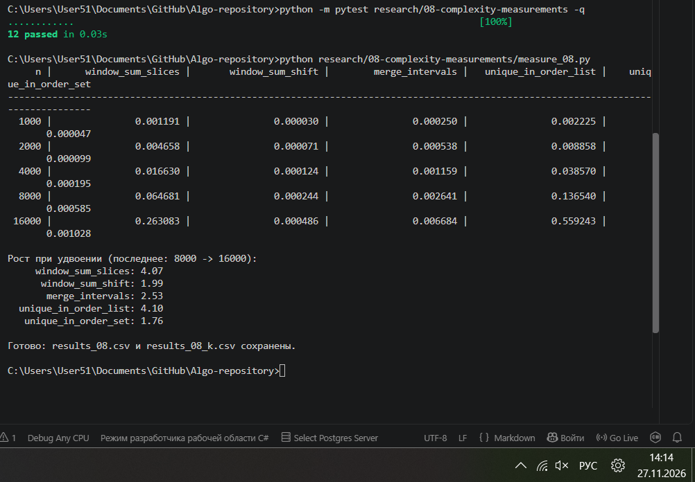
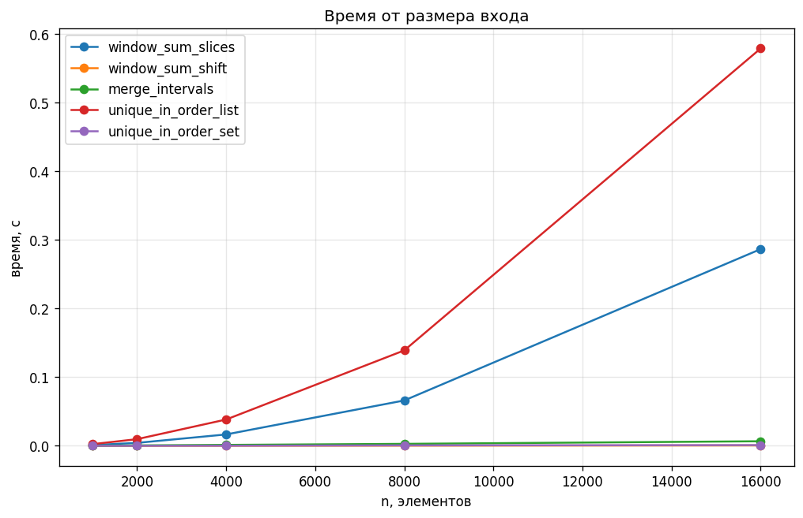
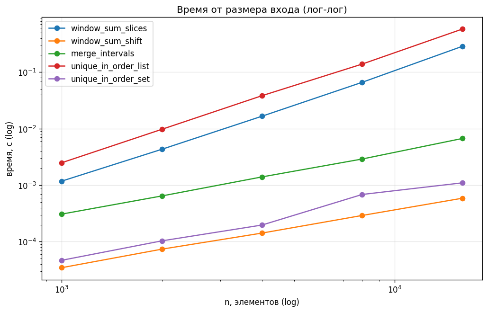
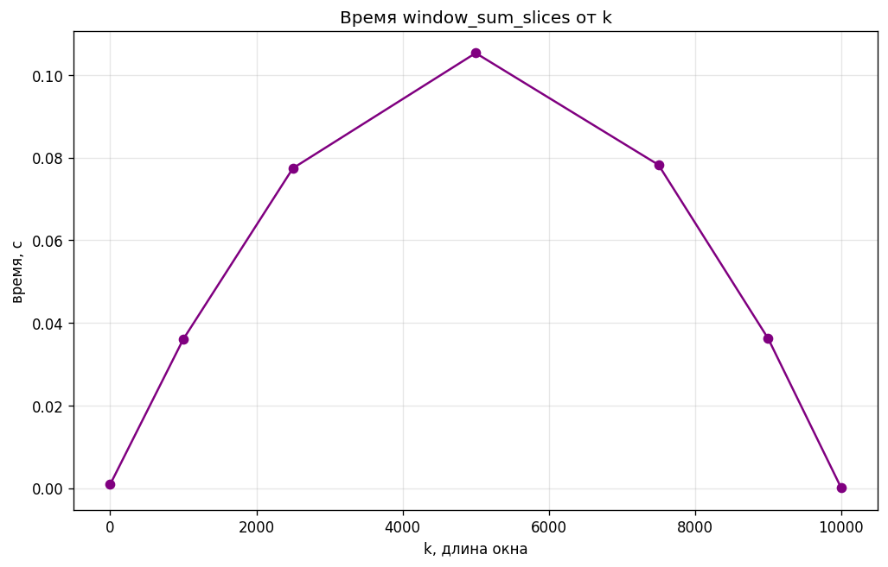

# Домашняя работа № 8 · Сложность по замерам и графикам

**Дисциплина:** ОП.04 «Основы алгоритмизации и программирования»

| Поле | Значение |
|---|---|
| Фамилия, имя, отчество | Клейновский Максим Андреевич |
| Группа | 9/3-РПО-24/2 |
| Номер работы | 8 |
| Тема работы | Замер пяти функций, рост при удвоении, графики |
| Дата сдачи | 27.11 |
| Ветка | `hw-08` |

Сначала сделайте прогноз по коду, затем сравните его с измерениями. В отчёте
важно не угадать класс сложности, а объяснить, откуда берётся рост времени.

---

## 1. Прогноз и замер

Прогноз заполните до запуска `measure_08.py`, по описаниям функций (docstring).
Ошибиться можно: замер покажет, где прогноз неверен. Рост при удвоении
возьмите из вывода программы, у последнего удвоения 8 000 → 16 000.

 Функция | Прогноз | Рост при удвоении | Сложность по замеру |
|---|---|---|---|
| `window_sum_slices` | O(n^2) | 4.07 | O(n^2) |
| `window_sum_shift` | O(n): один проход | 1.99 | O(n) |
| `merge_intervals` | O(n log n): из-за сортировки | 2.53 | O(n log n) |
| `unique_in_order_list` | O(n^2) | 4.10 | O(n^2) |
| `unique_in_order_set` | O(n) | 1.76 | O(n) |

В строке `window_sum_shift` стоит пример с одного компьютера. Замените рост своим.

---

## 2. Графики

- Какие линии на графике 2 идут круче остальных и что это значит: Круче всего идут линии `window_sum_slices` и `unique_in_order_list`. На графике это означает, что у них самая высокая степень роста - O(n^2) (наклон прямой равен 2). Линии `window_sum_shift` и `unique_in_order_set` идут более полого (наклон 1) - сложность O(n). `merge_intervals` с сортировкой и `window_sum_shift` с одним проходом растут
почти одинаково. 

- Можно ли по пяти точкам отличить O(n log n) от O(n)
и как бы вы поставили опыт, чтобы отличить точнее: По пяти точкам на таких  размерах до 16 000 отличить их сложно: рост O(n log n) составляет 2.15-2.5 раз, а O(n) - 2. Разница визуально почти незаметна, чтобы отличить точнее, нужно брать большие размеры входа (например, от 10^6 до 10^7), где разница в коэффициентах накопится, либо замерять не время, а точное количество выполненных операций (итераций цикла).

---

## 3. Загадочная функция

В `unique_in_order_list` всего один цикл по списку. Совпал ли замер
с вашим прогнозом? Какая строка кода определяет сложность и почему она
не O(1): Да, замер совпал - рост 4.10. Сложность определяет строка `if x not in result:`. Она неявно перебирает элементы списка от начала до конца, пока не найдет совпадение. Поэтому внутри цикла выполняется скрытый линейный поиск, что в сумме дает O(n^2).

Сколько времени она заняла бы на 1 000 000 чисел? Это в 62,5 раза больше,
чем 16 000. При O(n^2) время вырастет примерно в 62,5^2 ≈ 3 900 раз:
0.559 с * 3 900 ≈ 36.3 мин.

---

## 4. Время от длины окна

n = 10 000 не меняется, меняется только k. Окон n − k + 1, в каждом k чисел.

Почему график поднимается, а потом падает почти до нуля при k = n: График имеет форму параболы, потому что количество операций зависит от произведения k * (n - k) (длина окна умножается на количество окон). Максимум достигается в середине, когда k = n/2. При k = n цикл вообще не выполняется (окно одно), поэтому время падает почти до нуля.

Какая сложность у `window_sum_slices` через n и k, и почему в разделе 1
она вела себя как O(n²): Сложность - O(k * (n - k)). В разделе 1 мы задавали k = n/2, поэтому k * (n - k) = (n/2) * (n/2) = n^2/4, что по O-нотации дает O(n^2).

---

## 5. Вывод

Чего вы не увидели бы в коде без замера: Без замера сложно было бы догадаться, что `merge_intervals` растет всего в 2.5 раза при удвоении, почти как линейная. А также то, что оператор `in` для списка и для множества (`set`) дает  разную скорость работы: в списке он делает функцию квадратичной, а во множестве - линейной.

---

ИИ: использовал для проверки расчётов и оформления текста
